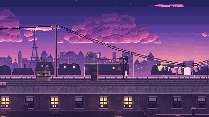
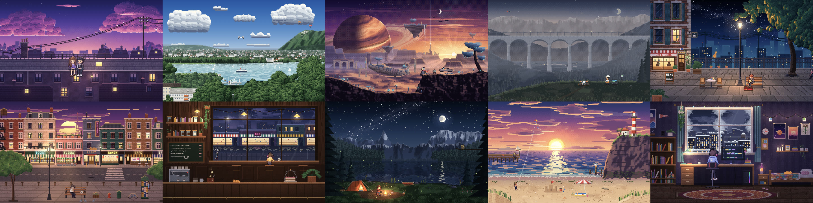
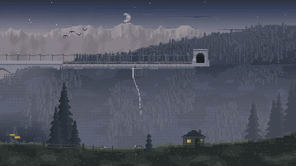
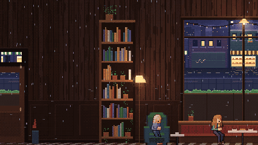
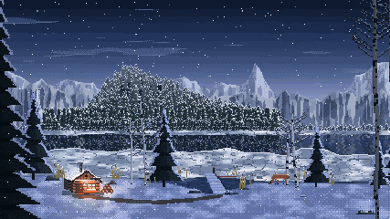

# Brume — la météo vit sur ton écran

> Une app macOS qui fait tomber neige, pluie, pétales et lucioles **sur ton bureau** —
> elles se posent sur tes vraies fenêtres — et qui transforme ton fond d'écran en
> **scène pixel art vivante**. Projet de lycée, open source.
>
> *A macOS app that makes snow, rain and fireflies fall on your desktop and settle on your
> real windows, with living pixel-art wallpapers. French high-school project, MIT licence.*

<p align="center"></p>

## En images

**9 scènes en pixel art**, qui changent avec la météo (neige, pluie, orage, cerisiers,
automne, nuit d'été, étoiles filantes) :

<p align="center"></p>

**L'animation d'ouverture** : chaque scène peint un monde plus large que l'écran, et la
caméra le longe jusqu'à s'arrêter pile sur ton fond d'écran (aucun raccord : la dernière
image *est* le fond d'écran). Elle peut aussi jouer sur l'écran de verrouillage.

| Drones | Café | Forêt |
|---|---|---|
|  |  |  |

**Le panneau** : la météo d'un côté, le décor de l'autre ; le reste derrière « Voir plus ».

<p align="center"></p>

## Installer

**En une ligne** (dans le Terminal) :

```bash
curl -fsSL https://raw.githubusercontent.com/Diduck/brume/main/install.sh | bash
```

Le script télécharge la dernière version, l'installe dans `/Applications` et la lance.

**Ou à la main** : télécharge `Brume-…-arm64.dmg` dans les
[Releases](https://github.com/Diduck/brume/releases/latest), ouvre-le et glisse Brume dans
Applications. Brume n'est pas signée par Apple (c'est un projet de lycée) : la première
fois, fais **clic droit → Ouvrir → Ouvrir**. Si macOS dit que l'app est « endommagée » :
`xattr -dr com.apple.quarantine /Applications/Brume.app`.

Mac Apple Silicon (M1 et suivants), macOS 14 ou plus récent. Brume vit dans la **barre des
menus** (le flocon).

## Lancer depuis le code

```bash
npm install
node node_modules/electron/install.js   # si npm a bloqué le téléchargement d'Electron
npm start                               # mode développement
npm run build                           # crée dist/mac-arm64/Brume.app
npm run dist                            # + le .dmg et le .zip d'installation
node tools/test-physics.js              # 13 tests de physique, sans écran
```

Nécessite macOS (Apple Silicon) et Node 20+. L'écran de verrouillage animé utilise
`ffmpeg` (`brew install ffmpeg`) ; sans lui, tout le reste marche.

Brume vit dans la **barre des menus** (icône flocon). Raccourci pause : ⌥⌘B.

## Ce qu'elle sait faire

- **La neige se pose sur le toit de tes fenêtres** et suit leurs déplacements.
- **Inertie réelle** : tire une fenêtre d'un coup vers le bas → la neige décolle puis retombe ;
  sur le côté → elle glisse et tombe par l'arrière ; arrêt net → elle continue sur sa lancée.
- **Coup de curseur rapide** dans un tas → la neige est projetée et retombe sur les fenêtres voisines.
  **Fermer une fenêtre** → tout ce qui était dessus tombe.
- **Boules de neige** : glisse doucement le curseur dans la neige pour en rouler une (elle grossit
  en ramassant la neige), attrape-la, lance-la (elle éclate si elle arrive trop vite), empile-les :
  2 boules = un bonhomme, 3 = un bonhomme complet (bras, boutons, chapeau ou écharpe).
- Feuilles et pétales s'empilent ; on peut **shooter dedans**. Les lucioles viennent voir le curseur
  quand il ne bouge plus.
- **Derrière les fenêtres** (par défaut) : rien ne passe devant tes applications, la barre des menus
  ou le Dock. Changer de bureau conserve la neige.
- **Fonds d'écran animés en pixel art** (option) : Sur les toits, Lac d'Annecy (avec les feux d'artifice de la Fête du lac, la nuit), Drones, Terrasse, Ville, Café,
  Forêt, Bord de mer, Chambre — ou **Auto**, qui choisit selon la météo et change de scène au fil
  de la journée. Dans Drones, une pilote guide un drone d'inspection qui scanne le viaduc.
  Décors peints une fois avec un éclairage calculé pixel par pixel, puis des personnages et animaux
  animés en continu (passants, cycliste, musicien, cliente qui lit, chat roux, cerf, renard, chouette,
  mouettes, crabe…). Chaque scène s'adapte au temps choisi (neige, pluie, orage, printemps, automne,
  nuit d'été, nuit étoilée) sans jamais doubler la météo.
  C'est un **vrai fond d'écran** : la couche animée est au niveau du bureau (sous les icônes), et une
  image fixe de la scène devient le fond d'écran macOS (Mission Control, « Afficher le bureau »).
  Ton fond d'origine est sauvegardé et remis quand tu choisis « Aucun ».
- **Animation d'ouverture** : chaque scène sait peindre un monde élargi (la rue continue, la
  forêt continue…) dont le centre est identique au pixel près au fond d'écran — vérifié par
  `tools/ext-check.js`. Une caméra « multiplane » (comme dans les vieux films d'animation) le
  longe, plan par plan, et s'arrête sur le cadre exact du fond. Le nom du compte du Mac
  s'affiche par-dessus.
- **Écran de verrouillage animé** (option) : aucune app ne peut dessiner sur l'écran de connexion,
  mais macOS y joue les fonds « Aerial » (des vidéos). Brume filme sa propre animation en 4K et
  la range à la place de la vidéo Aerial ; l'original est gardé et remis quand on désactive.
- **Easter egg** : sur la scène Drones, trace un cercle puis un trait vers le bas avec la souris,
  comme un coup de baguette… 🚂 Un train à vapeur passe sur le viaduc, suivi le jour d'une
  vieille voiture bleue volante, et la nuit de spectres encapuchonnés.
- **Tes icônes sur le fond d'écran** : ajoute une image ou l'icône d'une app (sélecteur ou
  glisser-déposer depuis le Finder), place-la où tu veux en la faisant glisser sur un écran
  miniature, règle sa taille (curseur ou molette), en version nette ou « pixel art » (redessinée
  aux gros pixels de la scène). Elle reste sous les icônes du bureau et apparaît aussi dans
  Mission Control.
- **Panneau** : une vraie fenêtre (déplaçable, boutons macOS), avec un aperçu vivant.
- **Météo actuelle** (en haut du panneau) : le vrai temps de ta position (approximative, par IP)
  ou d'une ville que tu choisis, avec la température et l'heure du relevé ; Open-Meteo. Quand il ne tombe rien,
  la saison décide : pétales au printemps, feuilles en automne, lucioles les nuits douces,
  étoiles filantes les nuits claires (hémisphère sud compris).
- **Économe** : la carte graphique s'arrête quand il n'y a rien à dessiner, pause sur batterie,
  qualité adaptative si le Mac peine.

## Créer ta propre scène

Tout est expliqué dans [AGENTS.md](AGENTS.md) — écrit pour qu'un agent de code (Claude Code,
Codex, Cursor…) puisse créer une nouvelle scène à partir d'une simple photo.

## Architecture

```
src/
  main/            processus principal (Node)
    main.js            fenêtres transparentes, barre des menus, énergie, curseur
    window-tracker.*   positions des vraies fenêtres via CoreGraphics (script JXA, ~80 Hz)
    weather.js         météo réelle (+ saisons)
    lockscreen.js      animation filmée pour l'écran de verrouillage (vidéo Aerial)
    wand.js            le geste de la baguette (easter egg)
    settings.js        réglages persistants
  preload/         pont sécurisé page ↔ processus principal (contextIsolation + sandbox)
  renderer/
    overlay.*          couche MÉTÉO (une par écran)
    ui.html, ui-main   couche INTERFACE (carte, notifications, boule tenue)
    wallpaper.*        couche FOND D'ÉCRAN (niveau du bureau, sous les icônes)
    pixel/             moteur pixel art, personnages (people.js) et les scènes
    intro*.js          animation d'ouverture (caméra multiplane)
    settings.*         la fenêtre de Brume (panneau de réglages)
    engine/lofi.js     ancien moteur de fonds (shader), gardé en secours
    ui/                panneau, aperçu animé, icônes SVG dessinées à la main
    fonts/             Young Serif (licence OFL), embarquée : l'app marche hors ligne
    engine/
      renderer.js      WebGL2 : une forme = un seul appel GPU (instancing)
      shaders.js       toutes les formes dessinées mathématiquement (aucune image)
      world.js         fenêtres, tas de neige (cartes de hauteurs), vitesse/accélération
      snowpack.js      neige posée, inertie, projections, boules, bonshommes
      effects/         neige, pluie/orage, sakura/feuilles, lucioles/étoiles/aurore
  shared/strings.js  TOUTES les phrases de l'app (pour l'exercice)
  shared/palettes.js couleurs des fonds lofi (shader + vignettes de la carte)
exercice/          décompiler → modifier une phrase → recompiler (voir exercice/GUIDE.md)
tools/             icônes générées, signature, empreinte asar, tests, fenêtres de démo
```

### Points techniques

- **Deux couches** : la météo est une fenêtre de niveau normal rangée tout au fond, donc macOS la
  cache lui-même derrière les apps. Quand macOS refuse (bureau plein écran), le shader découpe
  la météo à la forme des fenêtres (rectangles arrondis triés de l'avant vers l'arrière).
- **Tas de neige** : une hauteur par colonne de 3 px, avec éboulement à l'angle de repos,
  débordement aux extrémités, fonte, et accumulation.
- **Inertie** : la neige reste collée tant que l'accélération du toit vers le bas est inférieure à
  la gravité + la cohésion, et tant que l'accélération horizontale est inférieure au frottement.
- **Traqueur** : ~80 positions/s pendant un mouvement, ~16/s au repos. Il distingue une fenêtre
  fermée d'une fenêtre partie sur un autre bureau.
- **Aucune autorisation macOS** requise : seules les positions des fenêtres sont lues.

## Licence

Code sous licence **MIT** (voir `LICENSE`). La police Young Serif est sous licence SIL OFL
(`src/renderer/fonts/OFL.txt`). Toutes les scènes et personnages sont dessinés par le code
(aucune image externe).
